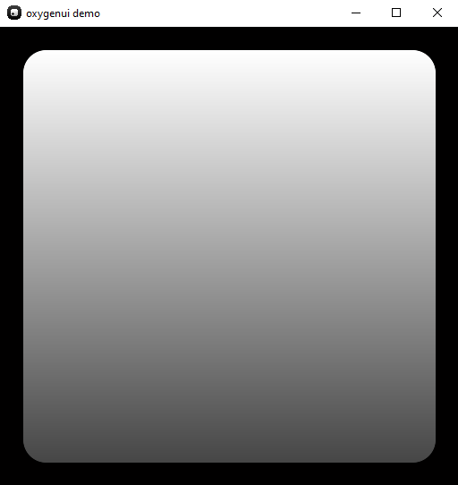

# Wiki

<!-- ### [ русский ](ruwiki.md) -->

## intro
so, the **oxygenui** as I said previously, is just an SFML wrapper. My lib can't directly
interface with your OS's drawing funcs, so it uses SFML as its rendering backbone.
<br>
<br>
**oxygenui** only can provide to **you** a convinient way to rapidly develop modern,
sleek-looking beautiful UIs.

------------------------------

## data types
oxygenui introduces several custom data types:

- **vector4** (and its close sibling vec4)
- **color** 
- **color_composition**
- **axis**
- **layout**
- **text_align_x** (and its counterpart text_align_y)
- **mousebutton**
- **event_t**
- **event** 
- **padding_t**


------------------------------
**vector4** — a UDim2-like vector structure

it's used primarly in describing ui object's **size** and **pos**

it stores:

* float **x_scale** — normalized relative X coordinate
* float **x_offset** — absolute X coordinate
* float **y_scale** — normalized relative Y coordinate
* float **y_offset** — absolute Y coordinate

 > "normalized coordinate" means that it's a float num from 0 to 1 (and > 1, basically percentages divided by 100).

------------------------------
**vec4** — a **vector4** analouge

it is a mathematical vector that stores:

* float **x** — normalized relative X coordinate
* float **y** — normalized relative Y coordinate
* float **z** — normalized relative Z coordinate
* float **w** — normalized relative W coordinate

------------------------------
**color** — a data type describing a specific color and its position in a linear gradient

it stores:

* sf::Color **content** — a 3 or 4-component vector describing the color in RGB(A)
* float **position** — a float number that describes color's position in the gradient

------------------------------
**color_composition** — an array of color data that defines the overall color of an object

it stores:

* std::vector<std::shared_ptr> **content** — an array of color instances

------------------------------
**axis** — a enum class specifying the axis used for calculations

it can be:

* width (default)
* height

------------------------------
**layout** — a enum class specifying how an object's children are positioned and sized.

it can be:

* none (default) — children are positioned independently of each other.
* flex_x — children fill the available space along the X axis.
* flex_y — children fill the available space along the Y axis.

------------------------------
**text_align_x** — a enum class specifying text justification

it can be:

* center (default)
* right
* left

------------------------------
**text_align_y** — a enum class specifying text alignment

it can be:

* center (default)
* top
* bottom

------------------------------
**mousebutton** — a enum class representing mouse buttons

it can be:

* left
* right
* middle
* none

------------------------------
**event_t** — a enum class representing the type of event that occurred with an object.

it can be:

* none — nothing happened
* mouseup — mouse button released on object
* mousedown — mouse button pressed on object
* scrollup - user scrolled up while hovering on object
* scrolldown - user scrolled down while hovering on object
* hover — hovering the cursor over the object

------------------------------
**event** — a struct that represents the event itself

it stores:

* event_t **type** — the type of event
* mousebutton **button** — the pressed button
* sf::Vector2f **mouse_pos** — mouse position
* uiobject* **object** — a pointer to the object that event happend with

------------------------------

**padding_t** — a struct that represents padding dimensions along all four directions

it stores:

 * float **left** - do I even need to describe what this does
 * float **right**
 * float **top**
 * float **bottom**

------------------------------
## architecture
### basics
**oxygenui** uses nested architecture, which consists of **uisystems** and **uiobjects**.

------------------------------

### uisystem
**uisystem** is a container, which stores **uiobjects** and **tweens** in it.
<br>
Its main function is to make an isolated environment, that stores only those elements,
that belong to that "scene".
<br>
<br>
**uisystem** is mainly used to create different **"scenes"** (and also to make the code
somewhat clean).

### its properties are:

* **core properties:**
    * std\::vector<std\::shared_ptr<uiobject>> **objects** - an array of **uiobjects** that belong to that **uisystem**
	* std\::vector<std\::shared_ptr<tween>> **tweens** - an array of **tweens** that belong to that **uisystem**
    * sf\::Vector2f **window_size** - a two-component type float vector that describes app window dimensions

### its methods are:

* **core methods:**
    * void **draw(sf\::RenderTarget& win)** - draws every **uiobject** from that uisystem onto desired sf::RenderTarget (window / rendertexture)
    * void **sort()** - sorts **uiobjects** from that uisystem by their local **z-index** and then assigns a **global** z-index to **every** uiobject in that system
    * void **update_uiobjects(sf\::RenderTarget& win)** - redraws all uiobjects from that uisystem into their RenderTextures
    * void **update_tweens()** - updates every tween from that uisystem and continues the interpolation process forward
    * uiobject* **get_by_name(const std::string& target_name)** - returns a pointer to **uiobject** that **name** equals to the given one in arguments
    * uiobject* **get_by_id(int target_id)** - returns a pointer to **uiobject** that **id** equals to the given one in arguments
    * event **check_events(sf\::Event& ev, sf\::RenderWindow& win)** - returns **event** object that describes what event has happened in current frame, how it happened and for what uiobject it happened

------------------------------

### uiobject
**uiobject** is a big-ass container that describes what to draw and how.
<br>
<br>
It combines a **Frame (\<div>\)**, **ImageLabel (\\)**, **Image/TextButton (\<button>\)**
and a **TextLabel (\<a>\)** in itself.
<br>
<br>
Every **uiobject** belongs to its **parent** element. It can be either the program window
itself, or an another **uiobject**.
<br>
<br>**uiobject** **size**, **pos** (and some other properties) rely on **relative** 
calculations, which means that **most** of the  uiobjects properties depend on their **parent**
elements dimensions / properties.
<br>
<br>
**E.g. size** of **child** uiobject equals to **parent->size** vector * **child->size** vector.

### its properties are:

* **core properties**
   * bool **clickable** (default: ``true``) — flag that determines object's clickability
   
   * vector4 **size** — the size of the object relative to its parent
   
   * vector4 **pos** — the position of the object relative to its parent
   
   * float **visibility** (default: ``1.0f``) — the opacity of the object and its children relative to the object's parent **visibility**
   
   * float **roundness** — the corner radius in fraction of the app window's width
   
   * color_composition **background_color** — the fill color of object (it's actually a linear gradient, more on that later in the examples section)
   
   * color_composition **border_color** — the outline color
   
   * float **border_size** — the thickness of the object's outline relative to app window width
   
   * padding_t **padding** — the offset of the object from its parent boundaries
   
   * int **rotation** — the rotation of object in degrees relative to its parent
   
   * int **id** — an id of object (idk what to use it for, I don't even remember why I added it)
   
   * int **z_index** (default: ``0``) — the local z-index of the object
   
   * int **global_zindex** (default: ``0``) — the global z-index of the object
   
   * std::string **name** — user-assigned name of object
   
* **internal properties**
   * sf\::Vector2f **real_size** — the absolute size of the object in pixels

   * sf\::Vector2f **real_pos** — the absolute position of the object in pixels relative to its parent
   
   * sf\::Vector2f **absolute_pos** — the absolute position of the object relative to the app window
   
   * sf\::Image **img** — raw pixel data of the background_image
   
   * sf\::Sprite **sprite** — the main sprite of the object that then is drawn into the parent ``render_tex`` after call of the ``draw_obj()``
   
   * sf\::RenderTexture **render_tex** — the buffer canvas where the object and its children are drawn
   
   * sf\::Sprite **image_sprite** — the sprite of the background_image
   
   * sf\::Font **font** — the SFML font object thing

* **shadows**
   * float **shadow_size** — the blur radius of the shadow
   
   * sf\::Vector2f **shadow_offset** — the shadow offset along the X and Y axes
   
   * sf\::Color **shadow_color** — the color of the shadow
   
* **layout**
   * layout **layout_type** (default: ``layout::none``) — specifies the method of the object children distribution along its boundaries
   
   * sf\::Vector2f **flex_padding** — the gap between the children (doesn't work when layout_type = none)
* **texturing**

   * sf:\:Texture **background_image** — the texture object of loaded image
   
   * std\::string **image_path** — the path to the image on disk **(DO NOT USE TO LOAD THE IMAGE ITSELF, INSTEAD CALL `set_image() / set_image_from_mem()`!!!)**
   
   * bool **repeated** — a flag that enables repeating of the background_image
   
   * sf\::Vector2f **image_offset** — the offset of the background image
   
   * sf\::Vector2f **image_scale** — the scale of the background image
   
* **constraints**
   * float **aspect_ratio** (default: ``0.0f``) — forced aspect ratio of an object
   
   * axis **dominant_axis** (default: ``axis::width``) — the axis prioritized in calculations of the ``aspect_ratio``
   
   * float **min_w** / float **min_h** (default: ``0.0f``) — absolute minimal dimensions of object in pixels
   
   * axis **dominant_padding_axis** (default: ``axis::width``) — the axis from which padding of the object is being calculated

   * axis **dominant_flex_padding_axis** (default: `axis::width`) - the axis from which the padding of children is being calculated
* **text**
   * std\::string **text_content** (default: ``empty``) — the text string rendered into the object's render_texture.
   
   * sf\::Color **text_color** — the fill color of the text.
   
   * sf\::Color **text_border_color** — the outline color of the text.
   
   * float **text_border_size** — the thickness of the text outline.
   
   * sf\::Text\::Style **text_style** — the text font style formatting (Bold, Regular, etc.).
   
   * std\::string **font_path** — the disk path to the font asset file.
   
   * float **text_size** (default: ``1.0f``) — the text font size evaluated relative to the dominant_axis.
   
   * text_align_x **align_x** / text_align_y **align_y** — the alignment positioning of the text inside the object.
   
   * bool **text_wrap** (default: ``false``) — a flag enabling automatic word wrapping.
* **hierarchy**
   * uiobject **parent** — a pointer to the parent UI container.
   
   * std\::vector<uiobject*> **children** — an array of pointers to the object's child elements.

### its methods are:

* static std\::shared_ptr **create(uisystem& sys)** — creates new `uiobject` and pushes it to system given in the arguments

* void **add(uiobject\* child)** — adds specified element to `children` of an element

* void **sort()** — sorts children of an object by their local zindex

* void **set_image(std::string s, bool smooth = true)** — loads image from disk to object

* void **set_image_from_mem(const unsigned char\* data, std::size_t size, bool smooth = true)** - loads image from memory to the object

* void **set_font(std::string s)** - loads font from disk to the object

* void **set_font_from_mem(const unsigned char\* data, std::size_t size)** - loads font from memory to the object

------------------------------

### tween
**tween** is a small container, that describes what **uiobject's** properties changes
to interpolate **and how**.

### its methods are:

* **core methods:**
    * static **std\::shared_ptr<tween> create(uisystem& sys, uiobject\* target, tween_info info, std\::map<std::string, float> target_properties)** - creates the tween object itself
    
    * void **play()** - starts the tweening
    
    * void **pause()** - pauses it
    
    * void **stop()** - stops it
    
    * void **update(float dt)** - updates linked object's properties
    
    * bool **is_playing()** - returns either `true` if tween has is playing, or `false` if not
	
    * bool **is_finished()** - returns either `true` if tween has finished playing, or `false` if not
    
------------------------------
## idk examples

### working with images
to load the image to the object (and make it function like **ImageLabel / \**),
you need to use one of these calls:

```cpp
    oxyui::uisystem sys;

    auto sixseven = oxyui::uiobject::create(sys);
    sixseven->size = {1,0,1,0};

    //load image from disk
    sixseven->set_image("67.png", true); 
    //the "true" thing enables texture filtering for the texture
    
    //or

    //load image from memory (resources.h)
    sixseven->set_image_from_mem(six_png_dat, six_png_len, true); 
    //if you don't understand what is going on here, go read about SFML's resource loading from memory

```

to make the image bigger, or smaller, use this:

```cpp
    sixseven->image_scale = { 0.75f, 0.75f }; 
    //sets image's scale to 75% from its original width and 75% from its original height
```

if you want to make an infinite scrolling background, use this:

```cpp
    sixseven->repeated = true;
    sixseven->image_offset = { 32.f, 32.f }; //slightly offset it by 32px
```

### working with color

bc color in my lib is ussaly represented by a ``color_composition`` struct,
and not a sf::Color ( a 3(4)-component math vector describing color by RGB(A) ), I need to
teach you how to use my abomination of a lib

one-color fill:

```cpp
    oxyui::uisystem sys;

    auto indigo = std::make_shared<oxyui::color>(); //creating the color point object
    indigo->content = sf::Color(63, 0, 255, 255); //the last 255 is an alpha-channel (and actually it's not necessary here)
    indigo->position = 0.f;

    auto thing = oxyui::uiobject::create(sys);
    thing->background_color.content.push_back(indigo); //pushing that color point object to the thing's color composition
```

two-color fill:

```cpp
    auto indigo = std::make_shared<oxyui::color>(); //first color point
    indigo->content = sf::Color(63, 0, 255);
    indigo->position = 0.f;

    auto persian_blue = std::make_shared<oxyui::color>(); //the second one
    persian_blue->content = sf::Color(28, 57, 187);
    persian_blue->position = 1.f; //important: this declares color point's position in the linear gradient

    auto thing = oxyui::uiobject::create(sys);
    thing->background_color.content.push_back(indigo); //adding the first one
    thing->background_color.content.push_back(persian_blue); //and the second one
``` 

also in theory you can add add infinite amount of color points! My lib isn't strict in this area,
as I said previously in ``README.md``, total creative freedom!

### working with the text

as for the most of the properties out there, text_size (aka font scale) is also being
calculated relatively here.

example uno

```cpp
    oxyui::uisystem sys;

    auto tr = std::make_shared<oxyui::color>(); //bc all uiobjects by default are filled with white color, we need to create a transparent color point
    tr->content = sf::Color::Transparent;
    tr->position = 0.0f;

    auto test = oxyui::uiobject::create(sys);
    test->size = { 1,0,1,0 };
    test->background_color.content.push_back(tr); //adding that transparent color point

    test->text_color = sf::Color(255,255,255);
    test->dominant_axis = oxyui::axis::height; //I am too lazy to derive it to a whole different property, so currently dominant_axis also does text things
    test->text_size = 0.025; // 2.5% from window height;

    test->text_border_color = sf::Color::Black;
    test->text_border_size = 0.01f;

    test->text_content = "pineapple on a pizza is a crime";
    test->text_wrap = true; //wraps text if it's too long for the uiobject

    test->set_font("comic_sans.ttf"); //sets font from disk
```

if you want to change font's style, use this:

example due
```cpp
    test->text_style = sf::Text::Bold;
```

there are also some properties which can help you in text alignment:

example tres

```cpp
    test->align_x = oxyui::text_align_x::left;
    test->align_y = oxyui::text_align_y::center;
```

------------------------------
## usage examples

### example 1
le simpliest example
#### uithing.h

```cpp
    #include "oxygenui-lib/oxygenui.h"

    oxyui::uisystem sys;

    void init_ui() {
	    auto thing = oxyui::uiobject::create(sys); //creating our "thing" object
	    thing->pos = { 0, 0, 0, 0 };
	    thing->size = { 1, 0, 1, 0 }; //making sure that thing width is equal to 100% of parent width (and same for height)
	    thing->roundness = 0.1; //making corners of the thing rounded by 10%
	    thing->padding = { .left = 0.1f, .right = 0.1f, .top = 0.1f, .bottom = 0.1f }; //10% padding from parent bounds

	    auto white = std::make_shared<oxyui::color>(); //creating first color point
	    white->content = sf::Color(255, 255, 255);
	    white->position = 0.0f;

	    auto gray = std::make_shared<oxyui::color>(); //creating second color point
	    gray->content = sf::Color(70, 70, 70);
	    gray->position = 1.0f; //making sure that gray color is in the end of the linear gradient

	    thing->background_color.content.push_back(white); //appending color points to the background_color(s) array
	    thing->background_color.content.push_back(gray);

	    sys.sort(); //sorting elements by their global z-index (not entirely necessary here)
    }
```

#### main.cpp

```cpp
    #include <iostream>
    #include <thread>
    #include <chrono>

    #include "oxygenui-lib/oxygenui.h"
    #include "uithing.h"

    void display(sf::RenderWindow& win) {
        win.clear({ 1,0,0 });
        sys.draw(win);
        win.display();
        sys.update_tweens();
    }

    void start(sf::RenderWindow& win) {
        sf::Event ev;

        sys.update_uiobjects(win);
        display(win);
        sys.update_uiobjects(win);
        display(win);

        while (win.isOpen()) {
            while (win.pollEvent(ev)) {
                if (ev.type == sf::Event::Closed) {
                    win.close();
                }
                if (ev.type == sf::Event::Resized) {
                    sf::FloatRect visibleArea(0.f, 0.f, static_cast<float>(ev.size.width), static_cast<float>(ev.size.height));
                    win.setView(sf::View(visibleArea));

                    sys.update_uiobjects(win);
                    display(win);
                }
            }
            std::this_thread::sleep_for(std::chrono::milliseconds(200));
        }

        sys.objects.clear();
    }


    int main() {
        sf::ContextSettings st;
        st.antialiasingLevel = 8;
	    sf::RenderWindow win;
	    win.create(sf::VideoMode(512,512), "oxyui example1", sf::Style::Default, st);

        win.setFramerateLimit(100);

	    init_ui();

        start(win);

	    return 0;
    }
```

#### result



### example 2
this example is too big for wiki.md, so I left it as a full blown vs project in `src` folder.
<br>[main.cpp](../src/main.cpp)
<br>[uithing.h](../src/uithing.h)